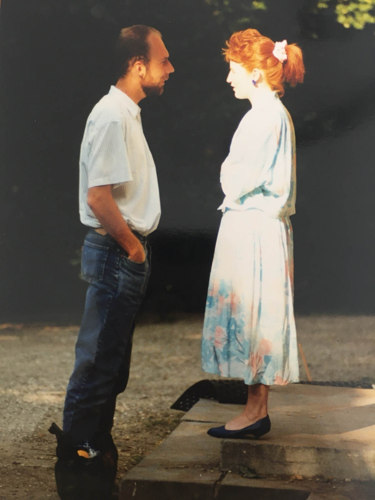

## Het Liefdeparcours

Ik herinner me nog goed het moment dat mijn hart ontvlamde, tijdens een boswandeling ergens op de heide bij Ede. De zon scheen door de bomen en raakte het prachtige rode haar van mijn vrouw, Michelle. Iedereen om me heen zag dat ik verliefd was – *being in love*.

Maar hoe houd je elkaar vast? Verliefd zijn is één ding, verliefd blijven is iets anders. Pas nog begeleidde ik een ouder echtpaar dat elkaar nog steeds verliefd aankeek. Ze hadden elkaar door de jaren heen vastgehouden, ondanks al hun onvolkomenheden. Een prachtige liefde, waar ik getuige van mocht zijn. Ook Michelle en ik ervaren steeds meer een verdiepende liefde voor en met elkaar.

Liefde is geen rechte weg, maar een uitdagend en waardevol parcours dat je samen bewandelt. Iedere relatie kent hoogte- en dieptepunten, obstakels en momenten van evenwicht zoeken. Het woord **ELKAAR** vormt de rode draad in elke partnerrelatie. De weg van verliefdheid naar een volwassen, verdiept liefdesniveau kun je vergelijken met een hindernisparcours. Dit parcours bestaat uit zes fasen, die relaties vaak doorlopen en waarin een herkenbaar patroon zichtbaar is.

Net als in een parcours kom je in een relatie hindernissen tegen: misverstanden, stress of externe druk. Dit vraagt om samenwerking met **ELKAAR** en veerkracht. Soms voelt het alsof je over een smalle brug loopt—balans houden vraagt om goede communicatie, vertrouwen en steun van je partner. Het is belangrijk om ook rustpunten in te bouwen, om samen op adem te komen en je verbinding te versterken.

In de zes fasen van **E.L.K.A.A.R.** zie je hoe liefde zich ontwikkelt en hoe partners samen groeien. Laten we deze fasen verder verkennen:

## E: Eenheid – De partners leven MET elkaar

Dit is de fase van verliefdheid: vlinders in de buik, hunkering naar elkaar en het gevoel samen de wereld aan te kunnen. Je ziet in de ander de ‘perfecte’ aanvulling op jezelf. Maar wat je eigenlijk verliefd maakt, is het gevoel dat de ander je geeft. De ego-grenzen vervagen tijdelijk, waardoor een magische eenheid ontstaat.

**Uitdaging**: Gehechtheid opbouwen door kwetsbaarheid te tonen en elkaar toegang te geven tot elkaars binnenwereld.

## L: Last van de verschillen – De partners strijden TEGEN elkaar

De verliefdheidsfase ebt weg en de verschillen worden zichtbaar. Eerst lijken ze nog boeiend en fascinerend, maar langzaam worden ze irritant. Dit kan leiden tot ruzies of – als conflicten vermeden worden – tot vervreemding.

**Uitdaging**: Trouw blijven aan je eigen behoeftes en gevoelens, en die inbrengen in de relatie zonder de verbinding te verliezen.

## K: Kolonisatie – De partners walsen OVER elkaar heen

In deze fase proberen partners elkaar te veranderen. Ze geloven dat als de ander zich aanpast, het conflict verdwijnt. Dit kan leiden tot controledrang, kritiek, zwijgen, manipulatie of andere vormen van machtsstrijd.

**Uitdaging**: Bewustwording van het patroon waarin jullie vastzitten en erkennen dat pogingen om de ander te veranderen niet werken.

## A: Autonomie – De partners staan LOS van elkaar

Er ontstaat afstand en de dreiging van overspel of een affaire wordt groter als de emotionele behoeften niet meer binnen de relatie vervuld worden. Partners worden zich bewuster van hun eigen verlangens en pijnpunten. Dit is een keerpunt: blijven of vertrekken?

**Uitdaging**: Verantwoordelijkheid nemen voor je eigen geluk en eigenaarschap over je eigen gevoelens en groei.

## A: Acceptatie – De partners keren zich NAAR elkaar toe

Er ontstaat een diepere laag van verbinding. Je erkent je eigen rol in de patronen en ziet je partner zoals hij of zij werkelijk is, zonder de illusies uit de beginfase. De relatie wordt een bewuste keuze in plaats van een vanzelfsprekendheid.

**Uitdaging**: Toegewijd blijven aan het proces van samen groeien, oude overtuigingen loslaten en elkaar opnieuw leren kennen.

## R: Realistische relatie – De partners leven BIJ elkaar

Dit is de fase van volwassen liefde. Je waardeert de verschillen en ziet ze als een verrijking. De communicatie is open en eerlijk, zonder elkaar te willen veranderen. Er is een diep gevoel van ‘gekend en geliefd’ zijn.

**Uitdaging**: Inzien dat dit proces zich blijft herhalen op kleine en grote schaal. Liefde is een dynamisch parcours.

## Investeer in je relatie en houd elkaar vast

Ben je klaar om samen te werken aan de toekomst van jullie relatie? Het **Houd me Vast **relatieweekend biedt de perfecte gelegenheid om dieper te duiken in de emoties die jullie verbinden, en om handvatten te krijgen voor een liefde die blijft. Dit weekend is gebaseerd op **Emotionally Focused Therapy (EFT)**, en biedt een veilige en ondersteunende ruimte voor koppels om hun band te versterken.

De rust van het klooster, gecombineerd met de krachtige principes van EFT, maakt het de ideale setting om samen te groeien. Of je nu net begonnen bent met je relatie of al vele jaren samen bent, de inzichten die je opdoet, kunnen het verschil maken.

**Waarom wachten?** De plekken voor 2026 zijn beperkt! Met slechts een aantal beschikbare plaatsen per weekend, is dit de kans om samen te investeren in een sterker en dieper verbinding.

**Wil jij samen met je partner werken aan een liefde die blijft?** Klik dan op de onderstaande link om meer informatie te lezen en je aan te melden voor een van onze **Houd me Vast **relatieweekenden in 2026

We kijken ernaar uit om samen met jullie een liefdevolle en verbindende reis te maken!

**Wat zeggen onze deelnemers?**

💬 *“Het hele weekend was heel bijzonder en heel helpend. We hebben het weekend al aan meerdere mensen aangeraden en zijn heel blij dat we dit hebben gedaan.”*

💬 *“Een prachtig weekend gehad samen: een heel weekend zonder afleidingen, samen ondergedompeld in het ontdekken van patronen in je relatie, het samen opzoeken van de dieptes van je emoties en gevoelens waardoor er veel (meer) begrip en verbondenheid ontstaat.”*

💬 *“Een intensief en leerzaam programma, met nuttige take away’s. Behulpzame en liefdevolle begeleiding, waardoor wij waardevolle ontdekkingen hebben gedaan om onze relatie verder te verdiepen en nog meer verbinding te ervaren met elkaar.”*

**Wat zeggen onze trainers?**

💬 *“Ik zie hoe stellen elkaar weer emotioneel vinden. Hoe ze, na een weekend samen, opnieuw verliefd naar elkaar kijken – niet geforceerd, maar van binnenuit.” 
* 
💬 *“Ik voel hoe bijzonder het is dat koppels zichzelf en elkaar de tijd gunnen om de relatie aandacht en zorg te geven. De impact hiervan werkt door in hun gezin, hun omgeving – en dat is zo mooi!” 
* 
💬 *“Ik ervaar hoe diep verbindend het is wanneer mensen hun eigen gevoelens écht toelaten en die in een veilige setting met elkaar delen. Dát is de kracht van emoties: ze verbinden ons met elkaar.”*
