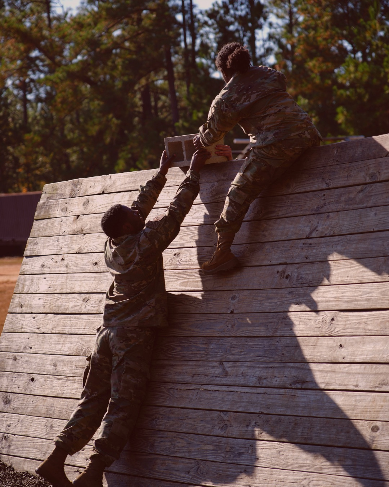

## "Ik dacht dat ze me wilden slopen, maar ze waren de enigen die door mijn muur heen prikten zonder me te veroordelen."

## Kamp van Koningsbrugge als relatie metafoor voor wat je samen te doen hebt

Er is iets aan **Kamp van Koningsbrugge**  TV show dat me niet loslaat. Niet alleen de modder, de kou, het geschreeuw, de afgematte gezichten. Het is vooral dat moment waarop iemand, midden in een opdracht, even niet meer kan. Niet omdat diegene zwak is, maar omdat het lijf en het systeem eindelijk stoppen met doen alsof alles “wel gaat”. En dan gebeurt er iets wat je in het dagelijks leven zelden zo rauw en helder ziet: er valt een pantser af.

Wat me steeds raakt, is dat de hardheid daar nooit het doel is. Het is een vorm van spiegelen. Een manier om bij iets te komen wat normaliter netjes onder controle blijft. Deelnemers zeggen vaak iets als: “*ik dacht dat ze me wilden slopen, maar ze waren de enigen die door mijn muur heen prikten zonder me te veroordelen.”* En als je eerlijk kijkt, zit er iets pijnlijk herkenbaars in. Want in veel relaties gebeurt hetzelfde, alleen zonder helikopter, zonder hindernisbaan en zonder instructeurs die je terugduwen naar de kern. Je wordt óók gespiegeld, óók geconfronteerd, óók op je reflexen gepakt, maar dan door iemand die je het liefst niet kwijt wilt.

Relaties zijn, net als Kamp van Koningsbrugge, geen test van “hoe sterk je bent”, maar van **hoe je reageert als het spannend wordt**. Als je je niet gezien voelt. Als je bang bent om te falen. Als je iets nodig hebt, maar niet weet hoe je het moet vragen zonder jezelf kwijt te raken.

## “We roepen naar elkaar, maar de boodschap komt niet meer aan.”

## Het moment waarop het kantelt

Stel je een koppel voor dat van elkaar houdt, oprecht. Ze hebben goede dagen, ze lachen, ze weten precies waarom ze ooit voor elkaar kozen. En toch, de laatste tijd, lijken ze elkaar steeds mis te lopen. Niet op grote thema’s, maar op die kleine, herhalende momenten die zich langzaam opstapelen. Een opmerking in de keuken. Een blik die net te lang blijft hangen. Een stilte in de auto die ineens zwaar voelt. De één probeert contact te maken en krijgt geen antwoord. De ander wil rust en krijgt druk. En ergens onderweg verandert “samen” in “tegenover”.

Op een avond, na wéér zo’n gesprek dat nergens kwam, zegt de één: “Zie je wel, je bent er nooit.” Niet schreeuwend, maar scherp genoeg om iets open te snijden. De ander zucht, kijkt weg, zegt: “Laat maar.” En ineens is het er weer: die bekende scène waarin niemand wint, maar iedereen iets verliest. De één voelt zich alleen in de relatie. De ander voelt zich onveilig in het gesprek. En wat ze allebei eigenlijk willen, nabijheid, lijkt verder weg dan ooit.

Als je het van buitenaf ziet, lijkt het alsof de één boos is en de ander afwezig. Maar als je dichterbij komt, zie je dat het iets anders is. Je ziet beschermingsreacties. Je ziet twee mensen die iets heel kostbaars proberen te beschermen: hun waardigheid, hun plek, hun gevoel van verbondenheid.

## De boze beschermingsmuur

In veel relaties staat één partner sneller “aan”. Boos. Fel. Verdedi­gend. Soms zelfs controlerend, alsof er iets vastgezet moet worden voordat het weg kan glippen. Het kan eruitzien als dominantie, als strijdlust, als “altijd gelijk willen hebben”. Maar onder die buitenlaag ligt vaak iets veel zachters, iets dat nauwelijks woorden krijgt op het moment dat het het hardst nodig is.

Daar zit dan een verlangen dat geen ingang vindt: *ik wil je bereiken, maar ik bots op stilte.* Daar zit een angst die meteen verkleedt als kracht: *misschien ben ik niet belangrijk genoeg voor je.* Daar zit een pijn die niet wil toegeven dat hij pijn doet: *ik voel me niet gezien.***

Boosheid is dan geen aanval. Boosheid is een harnas. Een pantser dat ooit hielp om niet overspoeld te worden, om niet opnieuw afgewezen te worden, om niet klein te hoeven voelen. Maar wat ooit bescherming was, wordt in een relatie al snel afstand. En hoe harder je duwt om contact af te dwingen, hoe meer de ander zich terugtrekt, niet omdat die ander niet van je houdt, maar omdat het systeem zegt: *dit is te veel, dit is gevaarlijk, dit moet stoppen.*

## De stilte- en terugtrekmuur

De andere partner reageert vaak precies tegenovergesteld. Stil worden. Wegkijken. De kamer uit. “Rustig blijven.” Geen woorden meer. Of juist praktische oplossingen aandragen om het ongemak te vermijden. Aan de buitenkant lijkt het kalmte of onverschilligheid, maar vanbinnen is het vaak een vorm van overleven.

Sommige mensen hebben geleerd dat kwetsbaarheid een risico is. Dat emoties escaleren. Dat je beter kunt verdwijnen dan iets verkeerds kunt zeggen. Dat je beter kunt slikken dan de controle verliezen. En dus wordt stilte een schuilplaats: *als ik me terugtrek, stopt de pijn.* Of: *als ik niks zeg, kan ik het niet fout doen.* Of: *als ik laat zien dat ik geraakt ben, gaat het alleen maar mis.***

Maar een schuilplaats is geen brug. Je kunt je er even veilig voelen, maar je komt elkaar er niet in tegen. En de ander—die juist contact zoekt—ervaart het als afwijzing. Als wegvallen. Als: *zie je wel, ik ben alleen.*

## Twee beschermingsreacties, één vastgelopen dans

En zo belanden stellen in een patroon dat bijna altijd uit liefde ontstaat, maar er na verloop van tijd uitziet als strijd. De één gaat duwen, omdat de verbinding zo broodnodig voelt. De ander trekt zich terug, omdat het gesprek te spannend voelt. De druk loopt op. De afstand groeit. En wat het extra pijnlijk maakt: allebei denken ze dat ze reageren op de ander, terwijl ze eigenlijk reageren op een oude alarmbel in zichzelf.

Dat is precies wat je op die hindernisbaan ook ziet. Je denkt dat de opdracht het probleem is, de kou, de pijn, de tijdsdruk, maar de echte strijd gaat over je reflex: ga je verharden of ga je voelen? Ga je doorduwen of durf je toe te geven dat je iets nodig hebt? Ga je op jezelf vertrouwen of ga je jezelf afwijzen?

In Kamp van Koningsbrugge zie je soms zo’n moment waarop iemand instort, niet dramatisch, maar menselijk. En juist dan gebeurt er iets onverwachts: er komt geen spot, geen afwijzing, geen “stel je niet aan”. Er komt begeleiding. Spiegelen. Aanwezigheid. Soms scherp, maar niet hardvochtig. Omdat precies daar geleerd wordt: op de plek waar je normaal weggaat, van jezelf, van de ander, kun je ook blijven.

## Confronterend én liefdevol

Wat veel mensen verwart, is dat echte betrokkenheid soms confronterend voelt. In Kamp van Koningsbrugge lijken instructeurs hard, maar je merkt: ze kijken je niet weg. Ze laten je niet ontsnappen in een verhaal. Ze gaan door het pantser heen, omdat ze zien dat er iets onder zit wat sterker is dan de houding waarmee je jezelf tot nu toe staande hield.

In relaties is dat niet anders. Soms heb je een spiegel nodig die niet meebeweegt met het patroon. Niet om schuld aan te wijzen, maar om helder te krijgen wat er werkelijk gebeurt. Niet: “jij bent boos en dus het probleem.” En ook niet: “jij trekt je terug en dus het probleem.” Maar: **wat beschermen jullie allebei, en wat kost dat jullie ondertussen?**

## Wat het Houd Me Vast-weekend hierin doet

Het **Houd Me Vast relatieweekend** van Redwoods  is een stevige, veilige setting waarin je niet blijft hangen in oppervlakkige communicatie-tips, maar leert begrijpen wat er onder jullie gesprekken speelt. Niet om je gelijk te halen, maar om jezelf en elkaar terug te vinden op de laag waar het vastloopt.

Je leert je eigen beschermingsmuur herkennen, de plek waar jij gaat verharden, controleren, duwen, pleasen, verdwijnen of zwijgen. Je leert ook zien wat er bij de ander gebeurt, zónder het meteen als aanval of afwijzing te interpreteren. En langzaam ontstaat er ruimte om iets anders te doen dan de bekende reflex. Om te zeggen wat je werkelijk bedoelt. Om te luisteren zonder jezelf kwijt te raken. Om weer samen te staan, in plaats van tegenover elkaar.

Niet met schuld. 
Wel met eerlijkheid. 
Niet met verwijt. 
Wel met kwetsbaarheid die stevig genoeg is om te blijven.

## Voor wie dit is

Voor stellen die merken dat ze elkaar kwijt raken in herhaling. Die steeds weer in dezelfde ruzies belanden, of juist in dezelfde stilte. Die weten: liefde is niet het probleem, maar er is iets tussen ons komen te staan. En die verlangen naar rust en nabijheid, niet door “harder hun best te doen”, maar door eindelijk te begrijpen wat ze samen steeds opnieuw activeren.

## De winst die blijft

In Kamp van Koningsbrugge is er een finish, een moment van “gehaald”. In relaties is er zelden applaus. Geen medaille. Geen publiek. Maar er is wel iets dat dieper rust geeft dan welke overwinning ook: het besef dat je elkaar weer kunt bereiken. Dat je zachter kunt worden zonder zwak te zijn. Dat je niet langer tegen elkaar hoeft te vechten, omdat je het patroon samen leert zien en samen leert doorbreken.

## Investeer in je relatie en houd elkaar vast

Ben je klaar om samen te werken aan de toekomst van jullie relatie? Het **Houd me Vast **relatieweekend biedt de perfecte gelegenheid om dieper te duiken in de emoties die jullie verbinden, en om handvatten te krijgen voor een liefde die blijft. Dit weekend is gebaseerd op **Emotionally Focused Therapy (EFT)**, en biedt een veilige en ondersteunende ruimte voor koppels om hun band te versterken.

De rust van het klooster, gecombineerd met de krachtige principes van EFT, maakt het de ideale setting om samen te groeien. Of je nu net begonnen bent met je relatie of al vele jaren samen bent, de inzichten die je opdoet, kunnen het verschil maken.

**Waarom wachten?** De plekken voor 2026 zijn beperkt! Met slechts een aantal beschikbare plaatsen per weekend, is dit de kans om samen te investeren in een sterker en dieper verbinding.

**Wil jij samen met je partner werken aan een liefde die blijft?** Klik dan op de onderstaande link om meer informatie te lezen en je aan te melden voor een van onze **Houd me Vast **relatieweekenden in 2026

We kijken ernaar uit om samen met jullie een liefdevolle en verbindende reis te maken!

**Wat zeggen onze deelnemers?**

💬 *“Het hele weekend was heel bijzonder en heel helpend. We hebben het weekend al aan meerdere mensen aangeraden en zijn heel blij dat we dit hebben gedaan.”*

💬 *“Een prachtig weekend gehad samen: een heel weekend zonder afleidingen, samen ondergedompeld in het ontdekken van patronen in je relatie, het samen opzoeken van de dieptes van je emoties en gevoelens waardoor er veel (meer) begrip en verbondenheid ontstaat.”*

💬 *“Een intensief en leerzaam programma, met nuttige take away’s. Behulpzame en liefdevolle begeleiding, waardoor wij waardevolle ontdekkingen hebben gedaan om onze relatie verder te verdiepen en nog meer verbinding te ervaren met elkaar.”*

**Wat zeggen onze trainers?**

💬 *“Ik zie hoe stellen elkaar weer emotioneel vinden. Hoe ze, na een weekend samen, opnieuw verliefd naar elkaar kijken – niet geforceerd, maar van binnenuit.” 
* 
💬 *“Ik voel hoe bijzonder het is dat koppels zichzelf en elkaar de tijd gunnen om de relatie aandacht en zorg te geven. De impact hiervan werkt door in hun gezin, hun omgeving – en dat is zo mooi!” 
* 
💬 *“Ik ervaar hoe diep verbindend het is wanneer mensen hun eigen gevoelens écht toelaten en die in een veilige setting met elkaar delen. Dát is de kracht van emoties: ze verbinden ons met elkaar.”*
