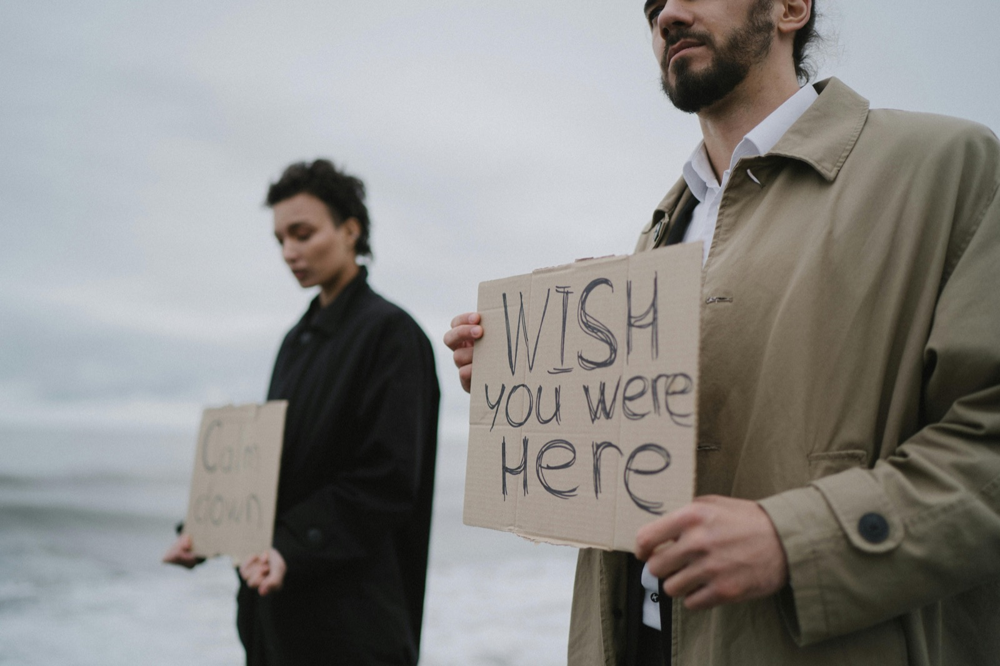
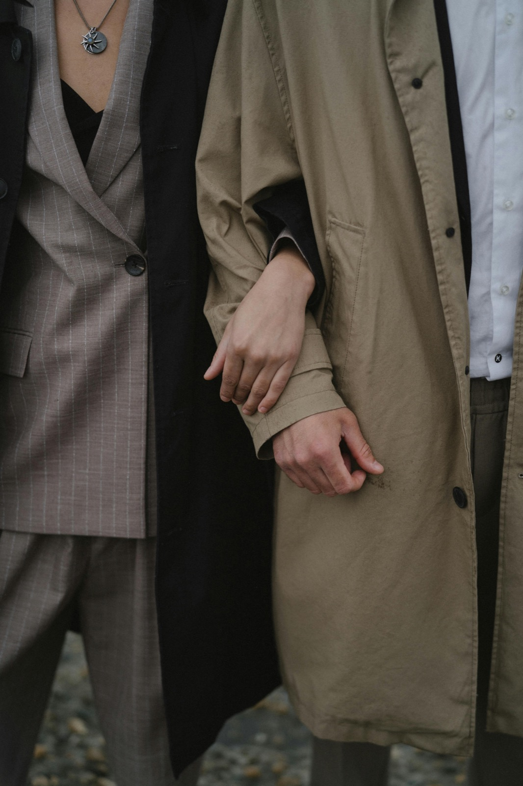

## Soms voelt een relatie alsof je samen op een ladder staat, maar ieder een andere kant opkijkt. Hetzelfde uitzicht, dezelfde storm, maar toch ver weg van elkaar. 

Je ziet de ander, maar je voelt geen verbinding. 

Het beeld is bijna pijnlijk herkenbaar: twee mensen die elkaar kwijtraken terwijl ze naast elkaar staan.

## Wanneer het leven te veel tegelijk vraagt, kan liefde dieper wortelen.

Iedere relatie kent zulke stormen. Ze zien er voor ieder stel anders uit.

Het kan gaan om verlies of ziekte, drukte en vermoeidheid, de zorg voor je kinderen of ouders of oude wonden die tussen jullie weer opspelen. Soms is het de stilte die tussen je in kruipt. En soms zijn het woorden die harder klinken dan je bedoelt. 
 
**Het stormt. ** 
 
De vraag is niet *óf* het komt, maar *hoe* je er samen doorheen gaat. Juist in stormtijd ligt een kans: om elkaar écht te vinden, patronen te doorbreken en duurzame, genadevolle liefde te bouwen.

## “We roepen naar elkaar, maar de boodschap komt niet meer aan.”

Op zulke momenten grijpen we vaak naar wat voorhanden is: we vragen om ruimte en krijgen verwijt terug. We zeggen ‘blijf bij me’, en de ander hoort ‘ga weg’. Alsof je naast elkaar staat met een bord in je handen, jij schrijft *“Wish you were here”*, de ander leest *“Calm down”*. Door gedrag, toon en het non-verbale, kunnen boodschappen soms verkeerd landen, ondanks goede bedoelingen. Het verlangen is groot, maar de vertaling stokt.

In onze samenleving is scheiden of uit elkaar gaan eigenlijk normaal geworden en scheiden een woord dat al snel valt wanneer het moeilijk wordt. De cijfers zijn bekend, de verhalen herkenbaar. Maar niet ieder stel dat uit elkaar gaat, wilde dat diep van binnen ook werkelijk in de tijd van de storm. We zien juist dat in of na zo’n storm soms afkeer of verharding ontstaat,  opgestapelde verwijten of opgebouwde wrok. Veel stellen blijven dan bij elkaar voor de kinderen die zó dierbaar zijn dat je alles daarvoor over hebt. En toch zien we ook hoe, wanneer er echt werk wordt gedaan, zoals; veiligheid opbouwen, patronen herkennen en herstellen, partners elkaar terugvinden, soms opnieuw verliefd worden en in liefde terugvallen. 
 
Het kan ook zijn dat de onbegrip simpelweg te groot is en er geen brug meer lijkt te zijn naar de ander. Soms is uit elkaar gaan dan wél de weg en dat vraagt om samen rouwen, om een nieuwe omgangsvorm te vinden en om los te laten.

Toch zien we bij Redwoods dat stormen niet altijd een einde hoeven te betekenen. Sterker nog: het zijn vaak de momenten waarop stellen onze praktijk binnenstappen. Niet omdat het stel gefaald heeft de storm op te lossen. Juist niet! Ze reiken uit naar hulp omdat ze nog steeds verlangen naar elkaar te bewegen alleen niet meer weten hoe.

## “Juist in de storm kan een uitgestoken hand de eerste brug zijn.”

In de gesprekken die ik voer, zie ik telkens weer hoe kwetsbaarheid en eerlijkheid ruimte scheppen. Je hoeft niet eerst alles op te lossen. De therapeuten helpen je bij de kwetsbaarheid en eerlijkheid te komen. Het is absoluut niet zwak om de hulp nodig te hebben.

Aan het einde van dit artikel wil ik je drie kleine oefeningen meegeven. Niet als oplossing, maar als begin.

Ga eens naast elkaar zitten en zeg hardop: *“Ik voel me ver weg van je, maar ik wil dichterbij komen.”* Laat de woorden in stilte landen.

Neem een minuut om elkaars hand vast te houden, zonder iets te zeggen. Voel hoe je lichaam reageert.

Vraag vervolgens zacht: *“Wat heb jij nu het meest van mij nodig?”* En luister. Alleen luisteren.

Dat zijn eenvoudige gebaren, maar vaak openen ze een weg die eerder gesloten leek.

Bij Redwoods werken we vanuit Emotionally Focused Therapy (EFT). In relatietherapie en in het programma *Houd me Vast* begeleiden we stellen om hun patronen te herkennen en te doorbreken. Niet omdat stormen te vermijden zijn, maar omdat liefde juist kan wortelen in het midden van de storm.

## “Verbinding groeit niet in de afwezigheid van pijn, maar in het samen dragen ervan.”

**Mijn eigen storm (persoonlijk verhaal van Cris)**

De dood van mijn moeder, een crisis in mijn familie van herkomst, het snelle hertrouwen van mijn vader, werkspanning én een innerlijk proces dat alles door elkaar liet buitelen, ik kón het niet tegelijk verwerken. Wat hielp? Het begrip van mijn vrouw. Dat ik rauw en eerlijk mocht spreken, zonder oordeel. Onvoorwaardelijke liefde. De ervaring dat we *samen* in de storm stonden. Liefde wordt niet alleen geboren in zonlicht; zij verdiept in de storm.

## Oefeningen

**Herken en benoem de signalen.**

Neem een rustig moment en zeg tegen elkaar wat je merkt bij jezelf: *“Ik merk dat ik sneller geïrriteerd ben”* of *“Ik voel me zo vlak dat ik moeilijk contact maak.”* Alleen het erkennen kan al lucht geven.

**Vertragen in plaats van reageren.**

Wanneer je voelt dat je lontje kort is, spreek af dat je een paar minuten uitstel neemt voor je reageert. Haal adem, loop even naar een andere kamer, en kom daarna terug met de intentie om te verbinden in plaats van te verdedigen.

**Een mini-anker van verbinding.**

Kies een klein ritueel voor stormachtige dagen, elkaar even drie seconden aankijken, elkaars hand vasthouden voor je gaat slapen, of samen een kop thee drinken in stilte. Klein, maar krachtig.

*Foto’s gemaakt door Anastasia Shuraeva – [**hier**](https://www.instagram.com/anastasia.shuraeva) te volgen op haar Instagram.*

## Houd me Vast relatieweekend -
Een korte, veilige, intensieve reset voor jullie relatie

Redwoods People Services organiseert in **oktober** een **relatieweekend **gebaseerd op de wetenschappelijk onderbouwde **EFT-methode (Emotionally Focused Therapy)** wat stellen helpt opnieuw veiligheid en verbinding te ervaren.

**Wat je meekrijgt**

- Helder zicht op jullie patronen en onderstroom.

- Concrete handvatten om negatieve cirkels te doorbreken.

- Oefeningen om dicht bij elkaar te blijven in stress en verlies.

- Veilige begeleiding door ervaren trainers.

**Praktisch**

📅  *Wanneer *– vrijdag 3 t/m zondag 5 oktober 2025

📍 *Waar** *– Het klooster van de Franciscanessen van Denekamp

👉🏻 *Begeleiding* * *– ervaren relatietherapeuten geven kundig en hands-on begeleiding tijdens het weekend.

**Wat trainers raakte tijdens een vorige relatieweekend**

*“Ik zie hoe stellen elkaar emotioneel terugvinden, zó echt dat er weer zacht naar elkaar gekeken wordt.”* — Michelle

*“De aandacht die ze hun relatie geven, werkt door in hun gezin en omgeving. Dat is zó mooi.”* — Joke

*“Als gevoelens veilig landen en gedeeld worden, ontstaat er verbinding. Dáár zit de kracht.”* — Joost
